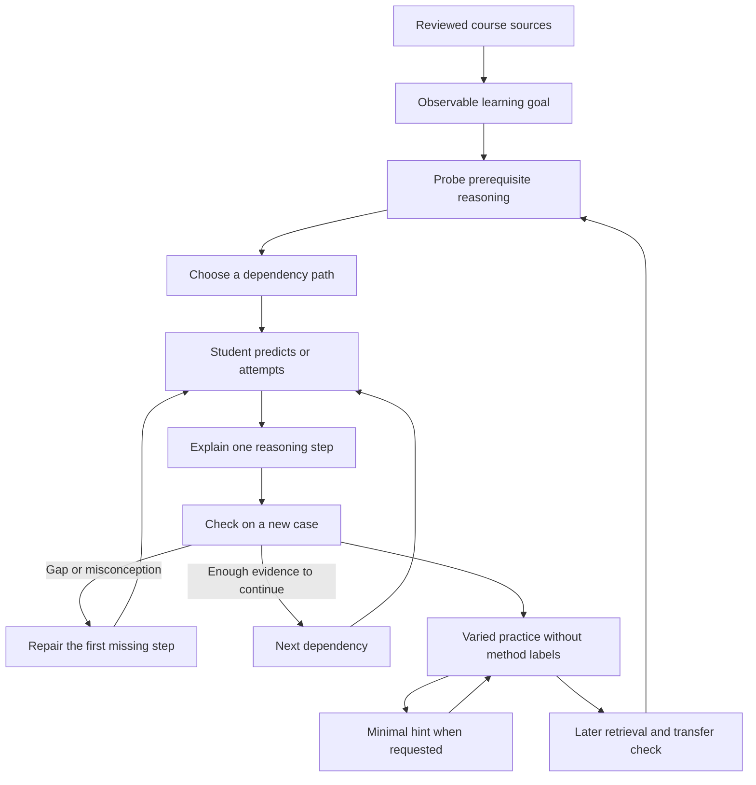

# LearnHarness ideas for TUM learning content and practice

Reviewed on 25 October 2026. Research and design recommendations only.

LearnHarness offers a useful direction for our TUM study workflow: organize teaching around the reasoning a student needs to perform, then use their attempts to decide what needs explanation or practice next. Its most useful contribution is the connection between diagnosis, dependency planning, small teaching steps, and practice that requires choosing an idea without being told its name. The website presents this as a desktop environment for adaptive teaching and practice, with a persistent record of ideas and reasoning. [Website][website]

Our project already has much of the foundation: source-grounded lessons, explicit objectives, worked examples, flashcards, application questions, and review of missed items. The strongest first step would be to improve how we author explanations and problem families within that foundation. A persistent learner model or live tutor could follow if a small learning evaluation demonstrates a benefit. A graph visualization alone would not close the learning gaps identified here.

## Scope and evidence

The external sources are the [LearnHarness website][website] and the repository at commit [`0795ef197cca04f6a8e7d50d10ed4dc71bd1a0cc`][snapshot]. The review covers the teaching theory, active prompts, phase transitions, question and practice tools, knowledge graph contracts, extraction pipeline, and relevant deterministic test definitions. Local comparisons use the study authoring guidance, content schema, renderer, and audio guidance in this repository. No course accounts or private student records were read.

The distinctions below matter throughout:

- **Website claims** describe the intended product experience.
- **Active prompts** instruct the model how to teach; they do not guarantee compliance or educational effectiveness.
- **Code and contracts** establish particular mechanics and validation boundaries. This was a source review, not a live evaluation of the application.
- **Learning research** supports specific mechanisms under studied conditions. It does not validate LearnHarness as a complete product.
- **TUM recommendations** are adaptations to evaluate, rather than features already present.

Older design documents contain superseded descriptions. For example, the vision discusses learner understanding levels and typed graph edges; current contracts instead store propositions and reasoning chains. The architecture document also describes an older problem-set practice system, whereas the active practice prompts and tools implement a conversational problem stream. Current code and active prompts take precedence for the behavior described here. [Vision][lh-vision], [architecture][lh-architecture], [graph contracts][lh-graph], [practice tools][lh-practice-tools]

## What a learning harness contributes

A model can explain a topic when asked. A learning harness adds the surrounding process: what evidence to collect, when to pause for an answer, which tools are available in each phase, what persists, and how the next learning action is chosen. In LearnHarness, probing and teaching use distinct agent configurations over the same conversation history; practice has its own configuration and tools. This division separates measurement, explanation, and application while preserving the context that connects them. [Agent construction][lh-agents]

The important distinction is between **understanding an explanation while its ideas are active** and **bringing the right idea to mind in a different problem later**. The teaching cycle targets the former. The practice doctrine explicitly targets the latter. Our content and assessment should address both. [Teaching cycle][lh-predictions], [practice doctrine][lh-practice]

The theory also distinguishes useful mental effort from logistics. Finding reliable material, resolving prerequisites, and checking facts consume effort that could otherwise go into reasoning. Our source synchronization and authoring workflow already absorb much of that work. The adaptation should reduce unnecessary navigation and repeated explanations while preserving the effort of attempting a solution. [Teaching theory][lh-theory]

*Proposed TUM learning loop. It combines LearnHarness's teaching and practice ideas with explicit course-source review and delayed checks. Delayed review is an addition to evaluate, not an assertion that LearnHarness already supplies a retention scheduler.*

## How LearnHarness teaches

### Diagnose the boundary of prerequisite understanding

The prober first makes the goal concrete, then investigates the prerequisite strands needed to reach it. It looks for a demonstrated floor and a point beyond which the student cannot yet reason reliably. Answers, confidence, and the student's explanation inform the next question. A single miss should trigger nearby investigation because a slip, missing concept, and misconception can initially look alike. [Prober instructions][lh-prober]

For TUM, this suggests diagnostics that distinguish failures with different remedies. A student who cannot trace a graph algorithm may misunderstand path cost, the data structure, or the algorithm's invariant. Another generic question about the algorithm's name will not identify which explanation helps.

Treat the boundary as a provisional hypothesis. The prober's binary-search metaphor is useful for choosing informative questions, but prerequisite knowledge is not a single ordered scale. Correct answers on one strand do not prove neighboring skills. Diagnostics should have a sensible time budget and allow students to proceed or inspect prerequisites themselves.

### Plan a route from the demonstrated starting point

The teacher builds a dependency map toward the goal, omitting unnecessary repetition and unrelated material. The planning prompt treats map nodes as landmarks that may require several reasoning steps. The map can change when teaching reveals a missing foundation. [Planning prompt][lh-planning]

This gives content authors a useful question: **What must the student already be able to explain or do before this paragraph makes sense?** A lecture's order can remain the navigation structure while the teaching exposes the dependencies within it.

The runtime accepts a Mermaid plan, validates its structure, and persists the resulting map. Teaching questions reference valid node identifiers. A tagged question locates the lesson on the map; it does not certify that a node is mastered. [Plan tool][lh-plan-tool], [question tools][lh-tools], [phase derivation][lh-phases]

There is a small but instructive inconsistency: the planning prompt permits coarse nodes and no fixed size ceiling, while the plan tool description asks for 5–15 nodes and one reasoning step per node. A coherent teaching contract needs consistent language across prompts, schemas, tool descriptions, and interface labels. Copying instructions alone can preserve such conflicts.

### Build explanations through motivated reasoning

The theory describes understanding as propositions connected by derivations. Its desired experience is that disconnected facts become consequences of a smaller set of foundations. The teaching method asks both what the student can safely build on and how they could have arrived at the next idea themselves. [Teaching theory][lh-theory], [method prompt][lh-method]

Applied here, an explanation should show why a definition, operation, or formula is useful at the moment it appears. For an algorithm, that means explaining the problem an operation solves and the invariant that makes it valid. For a proof, it means explaining why the assumptions permit the next inference. For a software design comparison, it means explaining which requirement makes one alternative fit better.

Keep assumptions explicit. The method's preference for unconditional foundations needs adaptation in technical courses: a theorem under stated conditions, an empirical approximation, a convention, and a definition are different kinds of claims. We should preserve that distinction even when a simpler explanation would sound more certain.

### Use prediction and checking for different purposes

LearnHarness separates a prediction before teaching from a check afterward. A prediction invites an attempt at the next idea and creates something for the explanation to resolve. A check asks whether the taught reasoning can be used. Its teaching interface presents predictions openly and places checks after the explanation behind a reveal control. [Prediction instructions][lh-predictions], [teaching instructions][lh-teaching]

For our content, an attempted prediction should not be treated as evidence that the student has failed material they have not learned. A later check should be solvable from the lesson and should require a meaningful inference. Simply repeating a sentence from the preceding paragraph mostly tests recognition.

The question principles favor distractors that correspond to identifiable wrong models. This matches our existing requirement for realistic misconceptions and individual option feedback. The improvement is to make the feedback identify the reasoning break and direct the student toward its repair. [Question principles][lh-question-principles], [local teaching guidance][local-teaching]

### Read reasoning and confidence alongside correctness

The thinking fields are intended to expose assumptions, uncertainty, and the student's route through a problem. The confidence prompt distinguishes a tentative correct answer from a confident misconception, and provides an explicit way to decline guessing. [Thinking instructions][lh-thinking], [confidence instructions][lh-confidence]

These signals could make feedback more useful, but neither is a direct measurement of knowledge. A student can explain fluently and be wrong, use few words and understand well, or be poorly calibrated. Start with short prompts such as “Which assumption justifies that step?” and optional confidence categories. Requiring a long explanation or a precise probability for every easy question would add substantial friction.

## How practice differs from a teaching check

LearnHarness's practice doctrine asks students to retrieve an idea from the situation, choose it against plausible alternatives, and execute it. It distinguishes recall, discrimination, and composition, and favors varied problems, restrained hints, and revisiting difficulties in a fresh setting. The intended benefit is usable knowledge beyond the immediate lesson. [Practice doctrine][lh-practice]

The runtime contributes concrete structure. A problem carries a statement, mode, optional proposition targets, and a model solution committed before the student sees it. The tools permit one active problem, keep working traces attached to it, and record a conclusion with outcome, hint rung, error class, and retest flag. The committed solution supplies the eventual reveal. [Practice tools][lh-practice-tools]

These mechanics prevent some process failures, such as silently changing the reference solution after reading an answer. They do not establish that the solution is correct, that the chosen problem exercises its intended target, or that a model's feedback is fair. The reviewed deterministic tests cover interaction and persistence cases; they are not learning-outcome studies. [Practice flow tests][lh-practice-tests], [practice record tests][lh-practice-record-tests]

### Author families of demands around a learning objective

For our practice bank, each important objective should have several distinct ways to exercise it. The following are authoring categories, not proposed schema fields:

| Demand | What the student must do | Example shape |
| --- | --- | --- |
| Recall or generate | Produce the needed fact, operation, or short explanation | State the invariant needed at this point in a trace. |
| Discriminate | Choose between confusable methods or conditions | Compare two nearly identical cases where one assumption changes the valid method. |
| Compose | Combine several taught ideas | Trace an algorithm, explain a decision, and verify the result. |
| Reverse | Infer grounds from a conclusion | Identify which assumptions would justify a claimed result. |
| Challenge a premise | Locate where reasoning stops being valid | Remove one assumption and construct a counterexample. |
| Transfer | Recognize the same structure in a different setting | Solve a new representation of the same underlying problem. |

Changing only names and numbers is weak evidence of transfer. Change which feature supplies the cue, which alternative is tempting, or how the situation is represented. At the same time, preserve the intended reasoning demand so that a “new context” does not introduce an unrelated prerequisite.

### Choose the next demand from the observed difficulty

The doctrine prioritizes weak capabilities, premises used by many reasoning chains, and targets that have not been active recently. It moves from component retrieval toward discrimination and composition, adjusting difficulty within each mode. This is an instructional policy expressed in prompts, not a calibrated statistical model of knowledge. [Practice doctrine][lh-practice]

For our adaptation, distinguish the failure before selecting the next task:

| Observed difficulty | Useful next teaching or practice action |
| --- | --- |
| Relevant idea did not come to mind | Try a simpler cue, then later return to a less explicit one. |
| A confusable method was selected | Contrast cases that differ in the deciding assumption. |
| The right method was executed incorrectly | Inspect the first invalid calculation or operation. |
| The underlying proposition was misunderstood | Repair the explanation before increasing problem complexity. |
| The available answer gives insufficient evidence | Ask one targeted follow-up rather than assign a confident diagnosis. |

LearnHarness's conclusion contract can record several error classes and hint use, but a model assigning a label is still making an inference. Keep the student's actual work available for review and avoid turning one classification into a lasting ability judgment. [Practice tools][lh-practice-tools]

### Make method selection part of the task

A set titled “Use Dijkstra's algorithm” supplies the method before the student reasons about the situation. That is useful during initial practice of execution. A later mixed set should sometimes require the student to select a method from the assumptions.

Our Revision feature pools questions from selected topics, but the inspected implementation concatenates their items in course order and displays the original topic title. Pooling therefore provides infrastructure for mixed practice; it does not automatically produce interleaved, uncued method selection. [Revision renderer][local-revision], [practice renderer][local-practice]

The authoring goal should determine when a topic label helps orientation and when it gives away the answer. Students still need a way to reach the relevant explanation after attempting the problem.

### Provide useful help before the full reveal

For a future hint interaction, prepare progressively more informative assistance: point to a relevant given, ask about an assumption, narrow the candidate methods, name the method, outline the move, then show a worked step. Repair unclear wording immediately; ambiguity in the statement should not be treated as desirable difficulty.

A hint should address the earliest reasoning failure. If the student applies the wrong method correctly, more arithmetic guidance will not help. Ask them to inspect the method's precondition first. This is a proposed adaptation of LearnHarness's hint policy; its effectiveness and usability need checking with our tasks. [Practice doctrine][lh-practice]

The current renderer immediately displays the answer and explanation after a checked multiple-choice response. It has no progressive hint interaction. Authors can write better staged material and self-check prompts now, but storing hint use and controlling reveal would require a later product change. [Practice renderer][local-practice]

### Revisit mistakes through a new problem

Our “Try again” action clears the result for the same question. That can help a student inspect feedback, but an immediate correct retry after seeing the answer gives little evidence that they can retrieve the idea later. A stronger learning sequence would return to the same objective through a different problem after intervening material, and eventually in another session. [Practice renderer][local-practice]

Keep the observations distinct: first attempt, answer after a hint, answer after solution exposure, and later independent answer. An eventual correct response is useful progress, but it should not erase the earlier difficulty or be presented as proof of independent competence.

## What the persistent graph contains

Three structures should remain conceptually separate:

| Structure | Meaning | What it does not establish |
| --- | --- | --- |
| Lesson dependency map | A proposed route through the prerequisites for a session goal | That a visited node has been learned |
| Persistent content graph | Propositions and arguments encountered in teaching or imported notes | That the student can recall or apply them |
| Learner evidence | Observed attempts, explanations, assistance, and later performance | A permanent, context-free rating of ability |

LearnHarness's graph contracts store proposition names, precise statements, aliases, provenance, and reasoning chains. Each chain has jointly used premises and a conclusion. Separate arguments for the same conclusion remain separate chains. The displayed arrows are derived from that stored argument structure. This matters because “A and B together imply C” differs from “A alone implies C.” [Graph contracts][lh-graph]

A prerequisite relationship also differs from a logical implication. Knowing path costs may be necessary before learning Dijkstra's algorithm, but the concept “path cost” does not itself entail the algorithm's correctness. A future course map should distinguish pedagogical dependencies, mathematical arguments, definitions, and looser conceptual associations.

### Extraction records content rather than mastery

The current session extraction view uses assistant prose, excluding learner messages, thinking, quiz calls, and quiz outcomes. The extractor proposes core ideas and chains; an identity auditor finds equivalent existing propositions; a deterministic merger handles validated storage operations. The auditor's job is identity matching, not independently verifying the subject matter. [Coverage selection][lh-coverage], [extraction pipeline][lh-extraction]

Consequently, an extracted node is evidence that an idea occurred in teaching. It is not evidence that the student understood it, and a type or prompt calling a proposition true does not prove its truth. For TUM, any extracted content would still need a course-source anchor and review of its assumptions and derivation.

The website says teaching and practice share graph context. The inspected implementation makes this more specific: the prober has settings-gated session and proposition-name readers, and practice can use selected graph propositions or start from other material. This should not be interpreted as automatic injection of a complete, calibrated model of the student's understanding. [Website][website], [graph tools][lh-graph-tools], [practice tools][lh-practice-tools]

### What to borrow for TUM

Use the graph idea first as an authoring discipline. For an important objective, identify its claims, conditions, dependencies, supporting explanation, examples, and practice evidence. Reuse an explanation where it serves several units while preserving course terminology and semester-specific source versions.

If we later introduce structured records, keep course content and learner evidence separate. Conceptually useful learner observations would include the item and content revision, first attempt, assistance received, explanation, and date. A recommendation should be traceable to those observations and remain revisable. These are design candidates, not additions to the present schema.

Start with a short local dependency view or a list of missing prerequisites. A large cross-course canvas becomes worthwhile only if it helps students choose what to study or understand how ideas connect.

## What learning research supports

The mechanisms below are plausible reasons to test the approach. They do not establish that every part of the harness is effective.

| Mechanism | Relevant primary evidence | Implication for this project |
| --- | --- | --- |
| Retrieval beyond rereading | Roediger and Karpicke found better delayed retention after retrieval practice than repeated study of prose, despite repeated study producing greater confidence. [Study][research-retrieval] | Preserve flashcards and add opportunities to generate explanations and solutions. Immediate familiarity should not determine completion. |
| Mixed practice and method choice | Rohrer and Taylor's experiments separated spacing and mixing mathematics problem types; delayed tests favored those changes in their studied tasks. [Paper and author abstract][research-interleaving] | Evaluate mixed problem families where selecting the method matters. Do not assume random ordering alone improves every task. |
| Explaining worked examples | Chi and colleagues examined how students' self-explanations related to learning from worked examples. [Paper][research-explanation] | Ask for the reason behind a critical step, then examine the explanation rather than rewarding verbosity. |
| Review over time | Cepeda and colleagues found that effective study spacing depended on the later retention interval in their fact-learning study. [Study abstract][research-spacing] | Include delayed checks. Avoid declaring one fixed review interval optimal for all course material. |
| Difficulty near a productive level | Wilson and colleagues derived an approximately 85% training accuracy optimum for particular learning algorithms in binary classification settings. [Paper][research-difficulty] | Use observed difficulty to adjust support. This is not evidence for hard-coding 85% as the correct target for university proofs, programming, or every retrieval event. |

LearnHarness's owner theory goes further: it treats a goal feeling self-evident as the terminal learning condition and makes strong claims about why connected understanding persists. Those are its design commitments. We should require independent performance and later retention alongside the student's experience of clarity. [Teaching theory][lh-theory], [retrieval study][research-retrieval]

Also adapt the cadence. Checking every reasoning step can expose a gap early, but forcing an interaction after every simple fact may interrupt fluent readers. Treat “one meaningful inference, then an appropriate check” as an authoring principle to evaluate, with explanations and worked examples available when discovery would impose excessive difficulty.

## Where the current TUM workflow stands

The comparison below describes the inspected repository, not the quality of every course already prepared with it.

| Area | Existing support | Opportunity |
| --- | --- | --- |
| Course grounding | Source inventories, hashes, locators, and stale-source build checks | Link each important inference and misconception repair to the relevant source passage. |
| Lesson design | Objectives, prerequisite bridge, mechanism, worked example, pitfall, recap | Expose smaller reasoning transitions and add purposeful predictions and checks. |
| Recall | Revealable cards with Again and Got it ratings | Use generation and discriminating comparisons; interpret ratings as self-report. |
| Practice | Questions tied to objectives, with option feedback and explanations | Author families that exercise method choice, transfer, and justification. |
| Revision | Shared pools and review of Again ratings and incorrect answers | Evaluate interleaving, reduced answer cues, and fresh variants after mistakes. |
| Progress | Browser-local Boolean ratings keyed by unit revision and item identity | Richer attempt history would require an explicit later data design. |
| Feedback to authors | Anchored passage comments and a source-review workflow | Use repeated misunderstandings to improve explanations while keeping personal learning evidence separate. |
| Audio | Prepared-content narration with deliberate recall pauses and answer follow-through | Reuse better reasoning sequences and comparisons; listening does not demonstrate task performance. |

Sources: [study workflow][local-study], [teaching guidance][local-teaching], [content contract][local-content], [content schema][local-schema], [application state][local-app], [flashcards][local-flashcards], [revision][local-revision], [audio guidance][local-audio].

Two constraints are particularly relevant. First, the content schema's structured question type is multiple choice; open proof, code, or explanation tasks can appear as authored teaching text, but they do not thereby gain response capture or reliable grading. Second, authoring instructions require exactly four options, while the underlying schema accepts three to five. Schema validity and adherence to the pedagogical contract are already separate concerns. [Content schema][local-schema], [teaching guidance][local-teaching]

## A concrete teaching and practice example

The following is an authored, synthetic design example. It is not taken from a TUM course and does not claim official syllabus or exam coverage. A real unit would need the selected course's sources and notation.

### Goal and prerequisite probes

Goal: Given a small weighted directed graph, the student can execute Dijkstra's algorithm, explain why a minimum tentative distance may be finalized under its assumptions, and identify a case where that reasoning fails.

Before teaching, probe only the uncertain dependencies: whether path costs add, how a cheaper discovered route updates a tentative distance, and what “finalized” claims. A student who can calculate distances but thinks that first discovery guarantees optimality needs a different repair from a student who adds edge weights incorrectly.

### Teach the critical inference

Use vertices S, A, B, and T, with edges S→A of weight 2, S→B of weight 5, A→B of weight 1, A→T of weight 6, and B→T of weight 2.

1. After processing S, the tentative distances to A and B are 2 and 5. Ask which vertex seems safe to finalize and why.
2. Explain the key assumption: with nonnegative edge weights, extending a route through an unsettled vertex already costing at least 5 cannot produce a route to A cheaper than 2.
3. Check the inference on another small configuration. Ask why the argument depends on nonnegativity, rather than asking the student to repeat the next vertex's name.
4. Continue the trace: processing A improves B to 3 and reaches T at 8; processing B improves T to 5. Ask the student to distinguish tentative improvement from finalization.

The shortest route to T is S→A→B→T, with cost 5. The example should show both the arithmetic and the reason each finalization is justified. The dependency map is not a substitute for that explanation.

### Build a contrasting case and a hint sequence

Now use S→A of weight 1, S→B of weight 2, and B→A of weight −3. There is no cycle. Finalizing A at 1 before processing B fails to identify its true shortest distance, −1. Ask which premise of the earlier argument no longer holds.

If the student says A must be correct because it was selected first, begin by asking them to total the route through B. If needed, ask whether extending a path can now reduce its cost. Only afterward explain the failed nonnegativity argument in full. This helps distinguish an arithmetic slip from an incorrect model of finalization.

### Prepare later practice with less cueing

After initial tracing, mix tasks that require choosing a method under stated assumptions, completing an invariant argument, finding the first invalid step, and interpreting a differently drawn graph. Include a fresh counterexample after intervening tasks. Label worked solutions separately from prompts so that the student can attempt the reasoning first.

During eventual source-grounded authoring, prepare a reference solution and inspect alternative valid routes before releasing a question. A student should receive credit for a sound solution even if it differs from the reference. Where selecting a particular method is the learning objective, check that the question actually requires that selection.

## Recommended order of adoption

These are proposed priorities for a future task. No content, skill, schema, or renderer changes are made by this review.

### First improve authoring within the existing product

The highest-value trial is one difficult, source-grounded unit. For each important objective, author the prerequisite bridge, a motivated inference, a worked example, a plausible misconception, and a contrasting or transfer task. Add a prediction only when an attempt will make the explanation more useful. Keep the course's terminology and essential conditions visible.

Prepare several problems around the same objective with different cues and confusable alternatives. Write feedback that explains the first reasoning error. Add short open self-check tasks where proof construction, code, or explanation matters, with an honest distinction between a worked self-check and a graded activity.

These improvements can be drafted with the current content blocks, cards, and questions. The existing format cannot automatically deliver an adaptive conversation, store confidence or written reasoning, progressively reveal hints, or schedule fresh retests. Do not imply that better prose supplies those mechanics.

### Then evaluate focused learning interactions

If the authoring trial is useful, the most direct product candidates are response capture for short reasoning, a clear don't-know option, assistance before reveal, deliberate interleaving, and tracking a fresh later attempt separately from a corrected answer. Each should answer a specific learning need and preserve keyboard, touch, and narrow-screen usability.

Retain an explicit exit from a difficult problem. LearnHarness's doctrine sustains the attempt until it is solved or the learner chooses to end it; our adaptation should make that choice easy to find. Let students review a worked solution or pause without being trapped in repeated failure.

### Add persistent personalization only when it has a clear use

A modest course concept inventory and separate attempt record would be easier to validate than a large autonomous knowledge graph. Preserve stable objective and item identities, course and semester scope, source revisions, and the history needed to interpret earlier answers. Re-evaluate affected claims when course sources change.

Live tutoring would add ongoing model cost, latency, grading uncertainty, and a decision about which learning data leaves the machine. It should remain an optional future layer. The ordinary prepared study website should continue to work without a provider key.

## How to evaluate whether students learn more

Begin with one bounded topic and two comparable learning versions: the current well-authored approach and the proposed reasoning-and-practice approach. Keep objectives, source material, and study time comparable. If the same students try both, use different matched topics and balance the order so that previous exposure does not explain the apparent benefit.

| Question | Evidence to collect |
| --- | --- |
| Can the student perform the target reasoning independently? | A new problem completed without hints, with a rubric that accepts alternative valid reasoning |
| Does learning persist? | A later check using a parallel problem, rather than immediate repetition of the training item |
| Can the student recognize the idea in a different setting? | An unfamiliar representation or context with the same underlying demand |
| Are misunderstandings repaired? | A later explanation or counterexample that tests the previously failed assumption |
| Does the interaction add too much burden? | Time, skipped tasks, help requests, abandonment, and brief student feedback |
| Is feedback trustworthy? | Human review of sampled explanations and judgments, including disagreements with the model |

An immediate check followed by checks after two days and one week would be a practical initial evaluation schedule, chosen for feasibility rather than claimed optimality. Decide the task rubric and comparison before looking at results. Separate independent answers from assisted ones and report students who did not finish. Avoid treating a small pilot as a precise estimate of improvement across TUM courses.

Do not optimize around graph size, generated question count, session duration, or a higher score after revealing solutions. Those measures can increase without better retention or transfer. Exam preparation also requires eventual practice of whole proofs, longer tasks, and time management; the practice doctrine's preference for dense local decisions should not replace those course-specific demands.

## Boundaries for a future adaptation

**Preserve the existing course and credential boundaries.** Moodle identities, session locations, downloads, and compatibility tools remain outside the learning-content design. Course access must stay within selected scopes. A tutoring feature must not acquire authority to start, push, submit, or rebuild campus work merely because a learning recommendation requests it. [Project instructions][local-agents]

**Separate private learning records from publishable teaching.** The current website stores progress in browser storage, while comments have a separate local preview path. Future reasoning traces, confidence, and attempt histories should have an explicit storage and deletion design and stay out of published course artifacts. Publishing a prepared lesson would not authorize publishing a student's responses. [Study workflow][local-study], [application state][local-app]

**Treat course and model material as evidence, not instructions.** A document or imported note should not be able to change tool permissions, redefine the grading rubric, or trigger campus actions. Course-source citations and model-generated derivations need review before they become teaching foundations. [Local content workflow][local-content]

**Review provenance and reuse before copying artifacts.** LearnHarness identifies its source license as AGPL-3.0. This review recommends concepts and original adaptations. Any later copying of code or prompt text should include a deliberate license and attribution review for the intended distribution. [Repository][snapshot]

**Be explicit about external processing.** LearnHarness's website distinguishes local records from requests sent to model providers and optional services. Our current prepared site requires no such runtime service; future tutoring would need a clear decision about provider access, permitted course context, and student-visible cost. [Website][website], [local content contract][local-content]

## Decisions to carry into a future design discussion

The useful direction is clear enough to begin with authoring when requested. The remaining choices are narrower:

- Which course topic has an identifiable reasoning bottleneck and sufficient reviewed sources for a fair trial?
- Is the immediate need better prepared practice, or a live tutor that can respond to written reasoning?
- Which objectives require generated answers, proof, or code beyond the present multiple-choice interaction?
- What later independent performance would count as a worthwhile improvement for that course?
- If personalization proves useful, what evidence must persist, and what should remain private to the student?

## Source index

All external sources were accessed on 25 October 2026. Repository links below are pinned to the reviewed commit. The scientific sources support the limited claims in the research table; their findings are not presented as product validation.

### LearnHarness

- [Website and product explanation][website]
- [Repository snapshot][snapshot]
- [Teaching theory][lh-theory] and [method prompt][lh-method]
- [Prober instructions][lh-prober] and [probe completion tool][lh-probe-tool]
- [Planning prompt][lh-planning], [plan tool][lh-plan-tool], and [phase derivation][lh-phases]
- [Teaching prompt][lh-teaching], [prediction cycle][lh-predictions], and [question principles][lh-question-principles]
- [Thinking fields][lh-thinking] and [confidence interpretation][lh-confidence]
- [Practice doctrine][lh-practice], [practice tools][lh-practice-tools], [flow tests][lh-practice-tests], and [record tests][lh-practice-record-tests]
- [Agent construction][lh-agents] and [question tools][lh-tools]
- [Graph contracts][lh-graph], [coverage selection][lh-coverage], [extraction pipeline][lh-extraction], and [graph readers][lh-graph-tools]
- [Older vision][lh-vision] and [architecture description][lh-architecture], used with the supersession limits described above

### This project

- [Project boundaries][local-agents] and [study workflow][local-study]
- [Teaching guidance][local-teaching], [content contract][local-content], and [validated content schema][local-schema]
- [Application and progress state][local-app], [practice][local-practice], [flashcards][local-flashcards], and [Revision][local-revision]
- [Audio narration guidance][local-audio]

### Learning research

- Roediger and Karpicke, 2006. [Test-enhanced learning][research-retrieval]. Psychological Science, 17, 249–255.
- Rohrer and Taylor, 2007. [The shuffling of mathematics problems improves learning][research-interleaving]. Instructional Science, 35, 481–498. DOI: 10.1007/s11251-007-9015-8. Linked record includes the authors' abstract.
- Chi, Bassok, Lewis, Reimann, and Glaser, 1989. [Self-explanations][research-explanation]. Cognitive Science, 13, 145–182. Author-hosted paper.
- Cepeda, Vul, Rohrer, Wixted, and Pashler, 2008. [Spacing effects in learning][research-spacing]. Psychological Science, 19, 1095–1102. Linked record includes the authors' abstract.
- Wilson, Shenhav, Straccia, and Cohen, 2019. [The Eighty Five Percent Rule for optimal learning][research-difficulty]. Nature Communications, 10, 4646.

[website]: https://learnharness.ai/
[snapshot]: https://github.com/amosblomqvist/learnharness/tree/0795ef197cca04f6a8e7d50d10ed4dc71bd1a0cc
[lh-theory]: https://github.com/amosblomqvist/learnharness/blob/0795ef197cca04f6a8e7d50d10ed4dc71bd1a0cc/docs/teaching-methodology.md
[lh-method]: https://github.com/amosblomqvist/learnharness/blob/0795ef197cca04f6a8e7d50d10ed4dc71bd1a0cc/src/agent/prompts/teacher/05-method.md
[lh-prober]: https://github.com/amosblomqvist/learnharness/blob/0795ef197cca04f6a8e7d50d10ed4dc71bd1a0cc/src/agent/prompts/prober/10-probe-doctrine.md
[lh-probe-tool]: https://github.com/amosblomqvist/learnharness/blob/0795ef197cca04f6a8e7d50d10ed4dc71bd1a0cc/src/agent/tools/probe.ts
[lh-planning]: https://github.com/amosblomqvist/learnharness/blob/0795ef197cca04f6a8e7d50d10ed4dc71bd1a0cc/src/agent/prompts/teacher/10-planning.md
[lh-plan-tool]: https://github.com/amosblomqvist/learnharness/blob/0795ef197cca04f6a8e7d50d10ed4dc71bd1a0cc/src/agent/tools/plan.ts
[lh-phases]: https://github.com/amosblomqvist/learnharness/blob/0795ef197cca04f6a8e7d50d10ed4dc71bd1a0cc/src/core/phases.ts
[lh-teaching]: https://github.com/amosblomqvist/learnharness/blob/0795ef197cca04f6a8e7d50d10ed4dc71bd1a0cc/src/agent/prompts/teacher/20-teaching.md
[lh-predictions]: https://github.com/amosblomqvist/learnharness/blob/0795ef197cca04f6a8e7d50d10ed4dc71bd1a0cc/src/agent/prompts/teacher/28-predictions.md
[lh-question-principles]: https://github.com/amosblomqvist/learnharness/blob/0795ef197cca04f6a8e7d50d10ed4dc71bd1a0cc/src/agent/prompts/teacher/30-question-principles.md
[lh-thinking]: https://github.com/amosblomqvist/learnharness/blob/0795ef197cca04f6a8e7d50d10ed4dc71bd1a0cc/src/agent/prompts/shared/16-mental-model.md
[lh-confidence]: https://github.com/amosblomqvist/learnharness/blob/0795ef197cca04f6a8e7d50d10ed4dc71bd1a0cc/src/agent/prompts/shared/25-confidence.md
[lh-practice]: https://github.com/amosblomqvist/learnharness/blob/0795ef197cca04f6a8e7d50d10ed4dc71bd1a0cc/src/agent/prompts/practice/10-doctrine.md
[lh-practice-tools]: https://github.com/amosblomqvist/learnharness/blob/0795ef197cca04f6a8e7d50d10ed4dc71bd1a0cc/src/agent/tools/practice.ts
[lh-practice-tests]: https://github.com/amosblomqvist/learnharness/blob/0795ef197cca04f6a8e7d50d10ed4dc71bd1a0cc/tests/practice-flow.test.ts
[lh-practice-record-tests]: https://github.com/amosblomqvist/learnharness/blob/0795ef197cca04f6a8e7d50d10ed4dc71bd1a0cc/tests/practice-record.test.ts
[lh-agents]: https://github.com/amosblomqvist/learnharness/blob/0795ef197cca04f6a8e7d50d10ed4dc71bd1a0cc/src/agent/teacher-agent.ts
[lh-tools]: https://github.com/amosblomqvist/learnharness/blob/0795ef197cca04f6a8e7d50d10ed4dc71bd1a0cc/src/agent/tools.ts
[lh-graph]: https://github.com/amosblomqvist/learnharness/blob/0795ef197cca04f6a8e7d50d10ed4dc71bd1a0cc/src/core/contracts/graph.ts
[lh-coverage]: https://github.com/amosblomqvist/learnharness/blob/0795ef197cca04f6a8e7d50d10ed4dc71bd1a0cc/src/core/coverage.ts
[lh-extraction]: https://github.com/amosblomqvist/learnharness/blob/0795ef197cca04f6a8e7d50d10ed4dc71bd1a0cc/src/agent/subagents/extraction.ts
[lh-graph-tools]: https://github.com/amosblomqvist/learnharness/blob/0795ef197cca04f6a8e7d50d10ed4dc71bd1a0cc/src/agent/tools/graph.ts
[lh-vision]: https://github.com/amosblomqvist/learnharness/blob/0795ef197cca04f6a8e7d50d10ed4dc71bd1a0cc/docs/vision.md
[lh-architecture]: https://github.com/amosblomqvist/learnharness/blob/0795ef197cca04f6a8e7d50d10ed4dc71bd1a0cc/docs/architecture.md
[local-agents]: development.md
[local-study]: study.md
[local-teaching]: ../src/tum_mcp/bundled/skills/prepare-study/references/teaching.md
[local-content]: ../src/tum_mcp/bundled/skills/prepare-study/references/content.md
[local-schema]: ../src/tum_mcp/study_content.py
[local-app]: ../src/tum_mcp/bundled/course_app/site/app.mjs
[local-practice]: ../src/tum_mcp/bundled/course_app/site/learning.mjs
[local-flashcards]: ../src/tum_mcp/bundled/course_app/site/flashcards.mjs
[local-revision]: ../src/tum_mcp/bundled/course_app/site/revision.mjs
[local-audio]: ../src/tum_mcp/bundled/skills/audio-notes/references/narration.md
[research-retrieval]: https://www.psychologicalscience.org/journals/psychological-science/j.1467-9280.2006.01693.x/
[research-interleaving]: https://eric.ed.gov/?id=EJ786797
[research-explanation]: https://education.asu.edu/sites/g/files/litvpz656/files/lcl/chibassoklewisreimannglaser_0.pdf
[research-spacing]: https://pubmed.ncbi.nlm.nih.gov/19076480/
[research-difficulty]: https://doi.org/10.1038/s41467-019-12552-4
